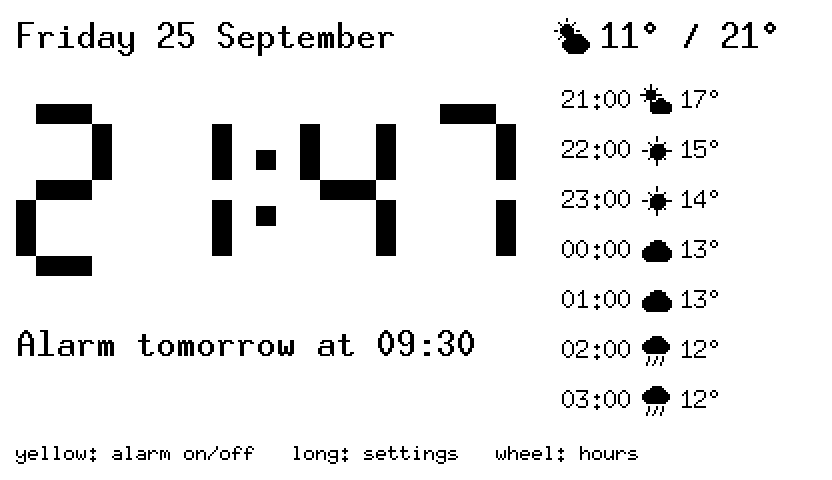
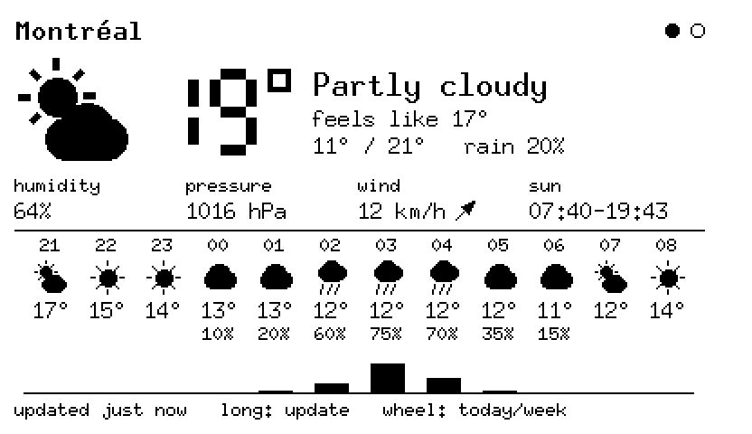
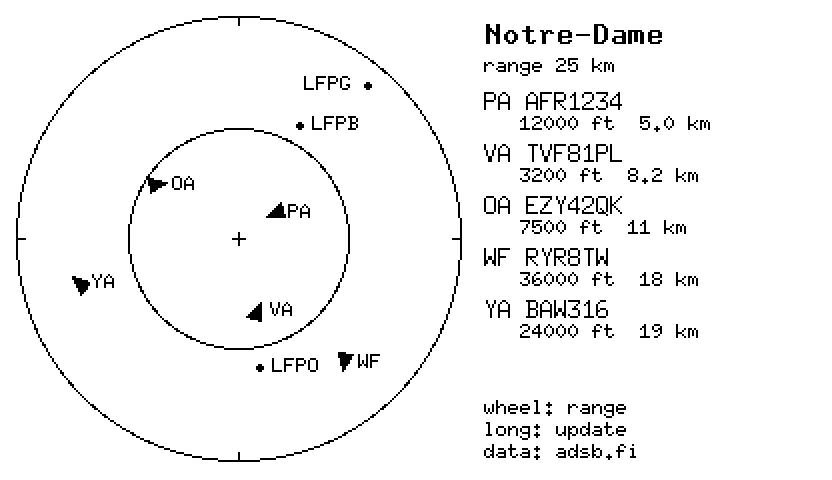
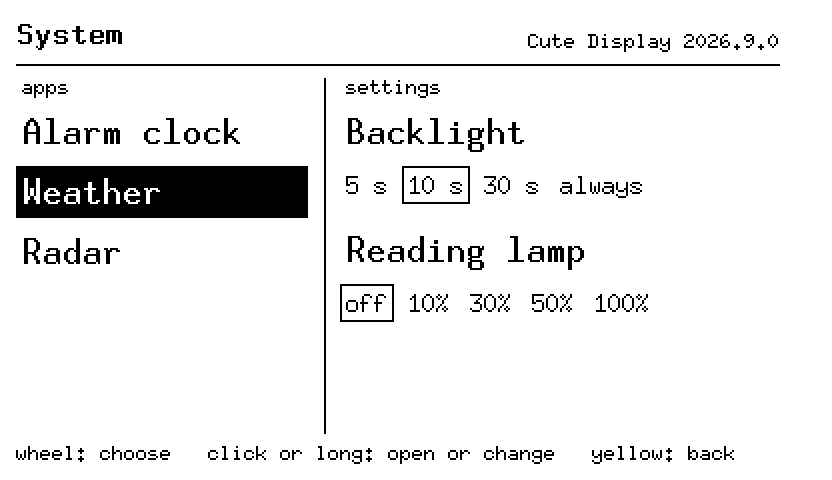

# Cute Display

Another firmware for the [Habity bedside clock](https://habity.design/products/bedside-clock).
It is an alarm clock. It shows the time, the weather and the planes near you on its
e-paper screen, and plays sounds to help you fall asleep. It is installed next
to Habity's own firmware, and one command brings Habity's firmware back.

| | |
| --- | --- |
|  |  |
|  |  |

## Apps

- [Alarm clock](docs/apps/alarm/README.md): the time, a wake-up time for each day, and
  a sunrise before it.
- [Weather](docs/apps/weather/README.md): today, the next hours, the week.
- [Radar](docs/apps/radar/README.md): the aircraft around you.
- [Zen](docs/apps/zen/README.md): a sound to fall asleep to, while the lights dim.
- [Timer](docs/apps/timer/README.md): a countdown, pomodoro rounds, or a nap that wakes
  you with the light.
- [Breathe](docs/apps/breathe/README.md): breathe to a rhythm, while the lights and a
  sound rise and fall with you.
- [System](docs/apps/system/README.md): opens the other apps, and holds the settings.

## Install

- [Installing](docs/install.md): what you need, then one command; how to go back to
  Habity's firmware.
- [Troubleshooting](docs/troubleshooting.md).

## More

- [Changelog](CHANGELOG.md): what each release changes.
- [Updating](UPDATING.md): what to know before you update. The installer shows it.
- [Notice](NOTICE.md): license, data sources, not affiliated with Habity.
- [Development](docs/development.md): building, flashing, and how the project is made.
